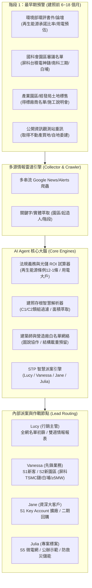

# ☀️ 進能服南區業務部 · 早鳥預警拓客 AI 戰情室 (Solar & Storage Early-Bird Lead Intelligence Platform)

專為**太陽光電（Solar PV）及表後儲能（BTM ESS）開發業者**打造的企業級業務開發 AI Agent 與視覺化戰情管理系統。

面對《再生能源發展條例》（新建物屋頂光電強制設置義務）與「用電大戶條款」之法規紅利，本系統徹底解決**「等拿到建照才去開發往往太晚」**的行業痛點，將情報雷達向前推移 **6 ~ 18 個月**，在建築師畫圖與環評階段即精準攔截！

---

## 🏗️ 一、 系統架構與業務流程



---

## 🚀 二、 三大系統化開發機制落地

### 機制 1：三層式情報雷達（自動化爬蟲與情報流）
- **第一層（關鍵字快訊雷達）**：實時併發抓取 5 大早鳥情報串流：
  1. `南台灣新興園區動態`：鎖定屏東科學園區、白埔產業園區、橋頭科學園區、南科三期等。
  2. `環評與工業區新闢`：環境部環評書件查詢、綠能比例承諾追蹤。
  3. `上市櫃重大訊息`：買地建廠、自地委建、廠房發包。
  4. `C類建照與工廠核發`：C-1（特殊廠房）、C-2（一般工廠）、I類（危險品廠房）。
  5. `微電網與儲能標案`：政府電子採購網、防救災微電網標案。
- **第二層（建照資料解析）**：自動判斷建築面積 $\ge 1,000 m^2$（符合再生能源發展條例強制設置屋頂光電義務門檻）或基地面積 $\ge 3,000 m^2$。
- **第三層（供應鏈順藤摸瓜）**：內建屏東科學園區與高雄白埔園區進駐清單（如宇晨材料、聚和國際、南亞科、帆宣、華懋、和淞、兆聯、安葆、矽科宏晟等）。

### 機制 2：改變攻擊節點 —— 綁定高頻建築師與廠務統包
- 內建南台灣（台南、高雄、屏東）最常承攬 C1/C2 工業廠房的活躍建築師白名單（九典、潘冀、喻台生、許銘陽、趙建銘、宗邁等）。
- **免費圖說協作策略**：提供免費繪製 3D 光電排佈、結構額外靜載重（15~18 kg/m²）簽證指引與台電責任分界點併網預審，在建照送審前將進金生規格畫進設計圖！

### 機制 3：內部派案漏斗（STP Lead Routing）
- **Lucy**：行銷主管統籌，每月產出《新園區與新建照潛在客戶雙週報》，執行線索第一道過濾。
- **Vanessa**：S1新開發與S2新工業園區（南科/高科/屏科 TSMC 神鏈、白埔、用電 $\ge 5\text{MW}$），主攻「法規義務光電 + RE100 綠電自發自用 + 削峰填谷儲能」。
- **Jane**：S1 Key Account 既有大客戶擴廠案，主打「一二期綜合維運、契約無縫擴充」。
- **Julia**：S5 智慧微電網標案，主打「EMS 能源管理系統 + 夥伴儲能生態系」。

---

## 🧮 三、 法規與光儲技術經濟試算模型

1. **《再生能源發展條例》第 12-1 條**：
   - 門檻：建築面積達 $1,000 m^2$（約 300 坪）以上。
   - 屋頂可用面積以 $65\%$ 估算，每 $kW_p$ 需約 $6.2 m^2$ 單晶高效率模組。
2. **「用電大戶條款」**：
   - 契約容量達 $5,000 kW$ ($5MW$) 以上，義務設置契約容量 $10\%$ 之綠能設備（或同等 2 小時放電儲能系統）。
3. **經濟效益試算**：
   - 南台灣年等效發電時數：$1,300 \text{ kWh / } kW_p \text{ / 年}$。
   - 自發自用 / 綠電轉供替代電價：約 $5.8 \text{ NT\$/度}$。
   - 儲能削峰填谷套利：尖離峰價差套利與超約罰款預防。
   - 投資回收期：約 $5.5 \sim 6.8$ 年。

---

## 🌐 線上部署與 Supabase 雲端串接

- **GitHub Pages 線上戰情室網址**：👉 [https://davidyeh51.github.io/solar-storage-lead-agent/](https://davidyeh51.github.io/solar-storage-lead-agent/)
- **GitHub 專案倉庫**：👉 [https://github.com/davidyeh51/solar-storage-lead-agent](https://github.com/davidyeh51/solar-storage-lead-agent)

### ⚡ Supabase BaaS 雲端資料庫串接指南
本專案採用 **GitHub Pages ✕ Supabase BaaS** 現代無伺服器架構，支援免後端純靜態雙向同步：
1. **執行 SQL 結構腳本**：
   - 登入 [Supabase Dashboard](https://supabase.com/dashboard/project/cowljafosekwvxithwjd/sql/new)
   - 複製專案根目錄的 [`supabase-schema.sql`](./supabase-schema.sql) 貼入 SQL Editor 並執行
   - 腳本將自動建立 `solar_leads`、`architects`、`early_radar` 資料表並強制啟用 **RLS (Row Level Security)** 行級安全防護
2. **網頁介面即時連線**：
   - 打開 [GitHub Pages 網站](https://davidyeh51.github.io/solar-storage-lead-agent/)
   - 點擊頂部右上角的 **「Supabase 設定」** 狀態標籤（系統已自動預填您的專案連線資訊）
   - 點擊 **「儲存並測試連線」**，狀態將轉為 **🟢 Supabase 雲端已連線**！
   - 點擊 **「同步本機案場至雲端」** 即可一鍵雙向更新案場與建築師網絡！

---

## 💻 四、 系統快速啟動方式

### 1. 安裝環境與相依套件
本專案已在系統配置完成，可直接執行：
```powershell
# 位於專案目錄：
# g:\我的雲端硬碟\1_大衛人生\A3. 知識管理\A3.1 大衛雲\DavidCloud\DavidCloud\大衛工作\4.0 功能層級\4.1 業務開發
```

### 2. 一鍵啟動 Web 戰情室
執行下列命令：
```powershell
python run_server.py
```
或直接使用 Uvicorn：
```powershell
python -m uvicorn server:app --host 127.0.0.1 --port 8088 --reload
```
啟動後系統會自動開啟預設瀏覽器，連線至：
👉 **http://127.0.0.1:8088**

---

## 📂 五、 專案目錄結構

```text
4.1 業務開發/
├── agent/
│   ├── __init__.py           # 套件初始化入口
│   ├── config.py             # 系統參數、團隊成員SOP、法規計算係數
│   ├── collector.py          # 多源實時情報爬蟲與關鍵字萃取引擎
│   ├── permit_parser.py      # 建照存根文字解析與法規自動結算模組
│   ├── roi_calculator.py     # 再生能源發展條例義務量與表後儲能 ROI 試算器
│   ├── architect_db.py       # 高頻率工業廠房建築師與營造廠白名單網絡庫
│   ├── lead_router.py        # STP 業務智慧派案與作戰卡生成引擎
│   └── ai_agent.py           # 業務 AI Agent 核心大腦 (戰情報告與諮詢顧問)
├── data/
│   ├── leads.json            # 結構化案場商機資料庫
│   ├── architects.json       # 建築師事務所檔案庫
│   └── radar_cache.json      # 實時情報雷達快取庫
├── web/
│   ├── index.html            # 現代全功能互動 SPA 網頁介面
│   └── static/
│       ├── app.js            # Vue 3 響應式前端業務邏輯
│       └── style.css         # 深色高科技戰情室自訂樣式
├── server.py                 # FastAPI 後端伺服器 (提供完整 REST API)
├── run_server.py             # 一鍵啟動伺服器與瀏覽器腳本
├── init_leads.py             # 指標案場種子資料初始化腳本
└── README.md                 # 系統完整操作手冊與業務戰略文檔
```
